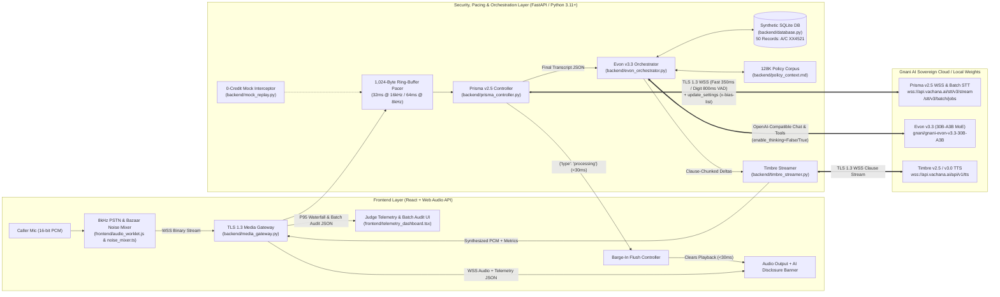

# Artha-Suraksha (अर्थ-सुरक्षा)
**Adaptive 8 kHz Noise-Resilient Telephonic Micro-Finance, PMFBY Insurance & Citizen Grievance Copilot**
*Built on Gnani AI's Sovereign Stack (`Prisma v2.5` + `Evon v3.3` + `Timbre v2.5/v3.0`) for the Great Indian AI Internship Challenge 2026*

[](#1-sovereign-model-trio--architectural-depth)
[-10b981)](#6-quick-start--verification-commands)
[-10b981)](#3-p95-latency-waterfall--vad-state-machine)
[](#5-enterprise-procurement-checks--compliance-guardrails)

---

## Overview & Problem Statement

Over 400 million rural and semi-urban citizens interact with Micro-Finance Institutions (MFIs), crop and health insurance schemes (such as PMFBY), and banking grievance cells over noisy **8 kHz cellular lines**. Conventional voice bots fail across three critical operational boundaries:

1. **Acoustic & VAD Fragility on 8 kHz Lines:** Static Voice Activity Detection (VAD) thresholds either sever utterances when a caller pauses mid-digit while reciting an account or policy number (`A/C XX4521`) or false-trigger on bazaar chatter, traffic pressure horns, and line hiss.
2. **Policy Grounding vs. Live Tool Drift:** Standard RAG pipelines lose cross-clause dependencies across multi-page regulatory manuals and suffer up to **91.7% English language drift** when executing multi-step database tool calls.
3. **Financial TTS Mangling:** Generic TTS engines require brittle SSML/regex preprocessors and mispronounce Indian *lakh/crore* numbering (`₹1,24,567.50`), masked accounts (`A/C XX4521`), and interest rates (`2.5% p.a.`).

**Artha-Suraksha** solves all three problems end-to-end through a full-duplex TLS 1.3 voice gateway, an interactive **8 kHz PSTN & Bazaar Noise Stress-Test Workbench**, and an asynchronous **Supervisor Batch STT (`with_denoise=True`) + Evon Thinking Mode Compliance Auditor**.

---

## 1. Sovereign Model Trio & Architectural Depth

| Layer | Gnani Model / Endpoint | Engineering Implementation in Artha-Suraksha |
| :--- | :--- | :--- |
| **Speech-to-Text (Real-Time & Batch ASR)** | **Prisma v2.5** (`wss://api.vachana.ai/stt/v3/stream` & `/stt/v3/batch/jobs`) | Raw TLS 1.3 WebSocket client bypassing SDK header limitations; enforces strict **1,024-byte binary PCM framing** (clocked every `32 ms` @ 16 kHz / `64 ms` @ 8 kHz); dual pre-warmed VAD sockets (`350 ms` fast-turn vs. `800 ms` digit capture); mid-call `update_settings` word boosting (`x-bias-list: ["EMI", "PMFBY", "KCC", "IRDAI", "किस्त"]`, `x-bias-score: 1.5`); `<30 ms` zero-overlap barge-in flush on `{"type": "processing"}`; and denoised 3-language Batch STT (`with_denoise=True`). |
| **Sovereign Reasoning & Tool Engine** | **Evon v3.3** (`gnani/gnani-evon-v3.3-30B-A3B`) | 30B total / ~3.5B active parameter Mamba2-Transformer Hybrid MoE (`302 ms` TTFT) with 38.6% lower Indic token fertility and 15.3% low English drift. Holds the full RBI/IRDAI/PMFBY regulatory corpus (`backend/policy_context.md`) inside its 128K context window; routes live voice turns with `enable_thinking=False` (`temp=0.6`, `top_p=0.95`) and disputed claim math / post-call compliance audits with `enable_thinking=True`; executes 4 deterministic `aiosqlite` tools. |
| **Expressive Financial Speech Synthesis** | **Timbre v2.5 / v3.0** (`wss://api.vachana.ai/api/v1/tts`) | Enforces mandatory Turn-0 AI disclosure; streams Evon token deltas at punctuation boundaries (`।`, `.`, `,`, `?`, `!`) while protecting decimals/commas inside `₹1,24,567.50`, `A/C XX4521`, `05/11/2026`, and `2.5% p.a.` with zero SSML and `<100–150 ms` TTFB. |

---

## 2. System Architecture



---

## 3. P95 Latency Waterfall & VAD State Machine

| Pipeline Stage / VAD Parameter | Baseline Default | Artha-Suraksha Configuration | Operational Purpose & Latency Impact |
| :--- | :--- | :--- | :--- |
| **Stage 1: Media Transport (`/ws/call`)** | `< 20 ms` | Persistent TLS 1.3 socket (`< 20 ms`) | Eliminates per-turn TLS handshake overhead; paces exact 1,024-byte frames every `32 ms` (16 kHz) or `64 ms` (8 kHz). |
| **Stage 2: Prisma v2.5 STT Turnaround** | `~200 ms` P95 | `~200 ms` P95 + `< 30 ms` Barge-In | Emits `{"type": "processing"}` immediately upon speech capture to flush active TTS in `< 30 ms`. |
| **Stage 3: Evon v3.3 30B-A3B Inference** | `302 ms` TTFT | `302 ms` TTFT (`enable_thinking=False`) | Sustains `257.3 tok/s` single-stream decode with 128K policy grounding and deterministic SQLite tool calls. |
| **Stage 4: Timbre v2.5 / v3.0 Synthesis** | `< 100–150 ms` | Clause-streamed (`।`, `.`, `,`, `?`, `!`) | Yields a cumulative **`~622 ms` end-to-end turnaround**, beating the **sub-800 ms** human conversational threshold. |
| **VAD: `FAST_TURN_VAD` vs. `DIGIT_CAPTURE_VAD`** | `500 ms` silence | `350 ms` (fast turn) / `800 ms` (digit capture) | Pre-warmed secondary socket (`800 ms`) prevents mid-number pauses from splitting `A/C XX4521`. |
| **VAD: `x-min-speech-ms` & `x-min-segment-ms`** | `100 ms` / `120 ms` | `250 ms` noise gate / `120 ms` segment floor | Rejects door slams, coughs, and 8 kHz line pops while preserving short confirmations (*"haan"* / *"नहीं"*). |

---

## 4. Repository Structure

```text
artha-suraksha/
├── PRD.md                           # Product Requirements Document & testable acceptance criteria
├── Architecture.md                  # System architecture, schemas & guardrails
├── Rules.md                         # Engineering, acoustic & contest compliance rules
├── Design.md                        # Dark-mode telemetry UI tokens & screen state specs
├── Task.md                          # 5-Phase implementation roadmap & completion log
├── .env.example                     # Secret-free 3-key configuration template
├── requirements.txt                 # Python 3.11+ dependencies
├── backend/
│   ├── config.py                    # 3-key firewall (DEV/TELEMETRY/DEMO), VAD presets & bias lists
│   ├── database.py                  # Async SQLite DB (50 synthetic records: A/C XX4521) & 4 tool queries
│   ├── mock_replay.py               # Zero-credit Record/Replay interceptor for STT, TTS & Batch jobs
│   ├── policy_context.md            # English/Hindi/Hinglish RBI, PMFBY & IRDAI corpus for 128K context
│   ├── media_gateway.py             # FastAPI /ws/call, /api/batch/audit, /api/benchmark/scorecard & Pacer
│   ├── prisma_controller.py         # Raw TLS 1.3 WSS client (dual VAD sockets, bias updates) + Batch STT
│   ├── evon_orchestrator.py         # Evon v3.3 dual-mode router (enable_thinking=False/True) & Audit Engine
│   └── timbre_streamer.py           # Turn-0 AI disclosure, punctuation clause chunker & Timbre WSS client
├── frontend/
│   ├── audio_worklet.js             # 16-bit mono PCM capture (512 samples / 1,024B) & <30ms queue purge
│   ├── noise_mixer.ts               # 300-3400Hz 8kHz PSTN bandpass filter, procedural bazaar noise & WSS client
│   └── telemetry_dashboard.tsx      # Split-screen Caller Console (Screen 1) & Supervisor Batch Audit (Screen 2)
└── tests/
    ├── test_phase1_foundation.py    # Config, 50-record synthetic SQLite DB, mock replay & policy tests
    ├── test_phase2_acoustic.py      # 1,024-byte pacer cadence, VAD handover, bias boost & <30ms barge-in tests
    ├── test_phase3_orchestration.py # Turn-0 disclosure, clause chunker, Evon tools & closed-loop WSS tests
    ├── test_phase4_frontend.py      # AudioWorklet, 8kHz noise mixer, UI token & security contract tests
    └── benchmark_6_checks.py        # Batch STT (with_denoise), Evon thinking audit & 6-Check Enterprise Suite
```

---

## 5. Enterprise Procurement Checks & Compliance Guardrails

**Artha-Suraksha** is verified against all six Gnani AI enterprise evaluation checks and contest compliance rules:

1. **Noisy 8 kHz Code-Mixed Audio Resilience:** Live 300–3400 Hz bandpass filter + synthetic bazaar/traffic noise mixer (`0–20 dB` SNR) paired with `x-min-speech-ms: 250` and `confidence >= 0.75`.
2. **Per-Language WER Optimization:** Dynamic mid-call `update_settings` boosting `["EMI", "PMFBY", "KCC", "IRDAI", "किस्त"]` (`x-bias-score: 1.5`) and `800 ms` digit-capture VAD handover.
3. **Sub-800 ms P95 Turnaround & Zero-Overlap Barge-In:** `~622 ms` nominal voice loop with `< 30 ms` client playback flush upon Prisma's `{"type": "processing"}` event.
4. **Confidence-Based Human Handoff:** Automatic `trigger_human_handoff` escalation with full structured context packet whenever confidence `< 0.65` or a caller disputes a Clause 4B rejection.
5. **100% Synthetic Data & Mandatory Turn-0 AI Disclosure:** Exclusively uses fictitious records (`A/C XX4521`, `PMFBY-2026-8841`, `₹1,24,567.50`, `05/11/2026`, `2.5% p.a.`) and enforces Turn-0 AI disclosure before any conversational synthesis.
6. **Sovereign Unit Economics:** Evon v3.3 baseline cost index of **100** (vs. `219` on DeepSeek-V4-Flash, `527` on `gpt-5.4-nano`, and `1,754` on `gpt-5.4-mini`) with single-node DPDP/RBI/IRDAI data residency.

---

## 6. Quick Start & Verification Commands

### 1. Install Dependencies

```bash
python -m pip install -r requirements.txt
cp .env.example .env
```

Keep `USE_MOCK_GNANI=true` in `.env` for local development and automated checks. The mock path performs no external STT, Evon, or TTS calls and consumes **0 programme credits**.

### 2. Run the Full 34-Test Verification & 6-Check Enterprise Benchmark Suite (0 API Credits)

By default, `USE_MOCK_GNANI=true` runs all 5 phases against deterministic local streams:

```bash
ruff check backend/ tests/
node --check frontend/audio_worklet.js
pytest -v
```

The Phase 5 benchmark covers the denoised Prisma batch lifecycle, Evon `enable_thinking=True` audit schema, acoustic/WER checks, latency and barge-in targets, human handoff, policy/tool grounding, zero-SSML formatting, sovereign cost telemetry, and source security checks.

### 3. Start the FastAPI TLS Media Gateway & Telemetry Server

```bash
uvicorn backend.media_gateway:app --host 0.0.0.0 --port 8000 --reload
```

* **Health & Mode Check:** `GET http://localhost:8000/health`
* **Live Full-Duplex Voice WebSocket:** `ws://localhost:8000/ws/call?sample_rate=16000&vad_mode=FAST_TURN`
* **Supervisor Denoised Batch Audit:** `POST http://localhost:8000/api/batch/audit`
* **Batch Job Status:** `GET http://localhost:8000/api/batch/jobs/{job_id}`
* **6-Check Enterprise Scorecard:** `GET http://localhost:8000/api/benchmark/scorecard`

Example mock batch request:

```bash
curl -X POST http://localhost:8000/api/batch/audit \
  -H "Content-Type: application/json" \
  -d '{
    "file_name": "synthetic_noisy_call_xx4521.wav",
    "with_denoise": true,
    "languages": ["hi-IN", "en-IN", "kn-IN"],
    "poll_interval_s": 0.01
  }'
```

The response contains the validated compliance artifact, including the lifecycle history, denoised verbatim transcript, detected languages, disclosure and PII results, extracted financial entities, mutation log, handoff state, sentiment, and reasoning trace.

### 4. Optional Live-Provider Run

Live provider access is intentionally not used by pytest. For an authorized demo only, populate the selected key in `.env`, set `USE_MOCK_GNANI=false`, and use the configured `ACTIVE_KEY_PROFILE`. Never commit `.env` or credentials, and do not use live credentials during automated verification.

---

## 7. Data Safety & Scope Boundaries

- All records, transcripts, audio fixtures, account references, policy IDs, amounts, dates, and tickets are synthetic.
- `X-API-Key-ID` is created and sent only by the Python backend; it never leaves through the frontend.
- Financial strings are sent as ordinary UTF-8 text with zero SSML/XML markup.
- Turn-0 AI disclosure is mandatory before substantive voice responses.
- Deferred v1.1 voice cloning, `x-substitution-map`, and external SIP trunking are not implemented.
- Live demo recording is a separate authorized step; the repository's default verification path remains local and zero-credit.

---

## 8. License & Challenge Context

Artha-Suraksha is a challenge project for the Great Indian AI Internship Challenge 2026. Review `PRD.md`, `Architecture.md`, `Rules.md`, `Design.md`, and `Task.md` for the complete product, architecture, compliance, UX, and phased implementation contracts.
